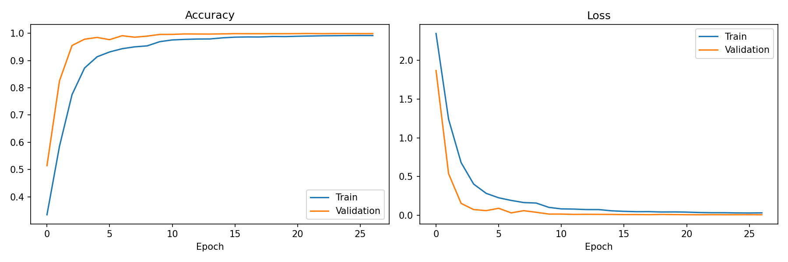
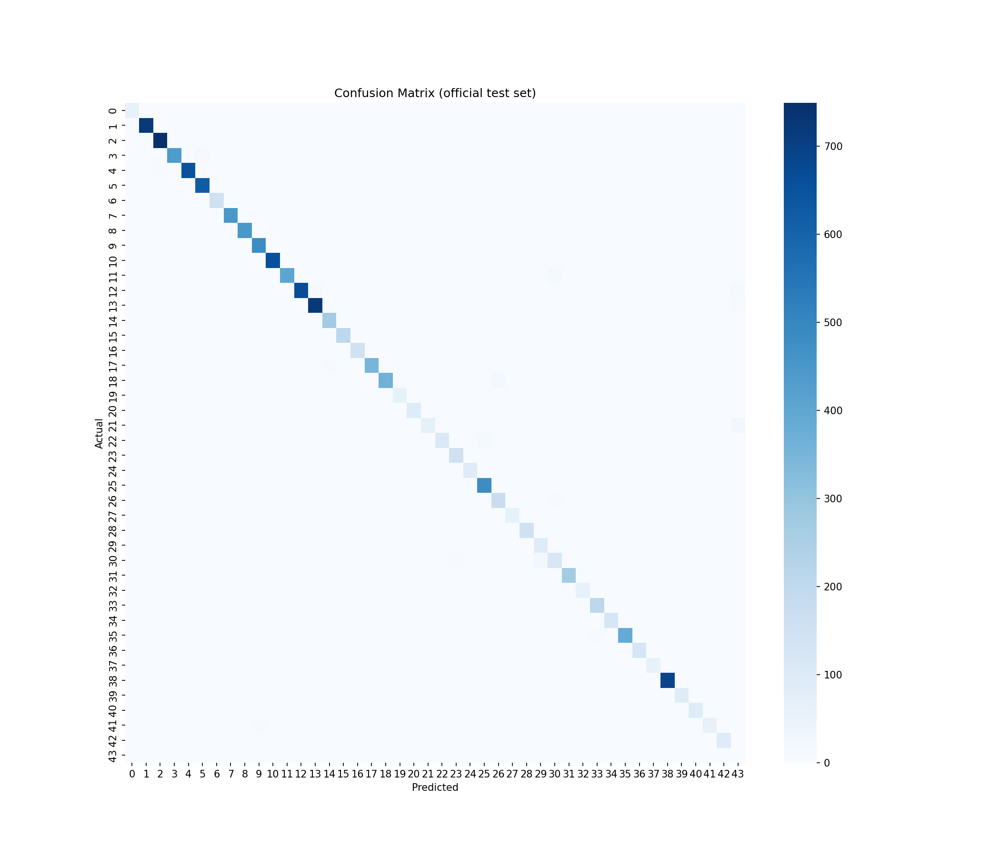

# SignSense AI: Traffic Sign Recognition

SignSense AI classifies traffic sign images into 43 classes using a CNN trained on the GTSRB dataset. Users upload an image in a Streamlit web app and get the predicted sign with a confidence score. Images that are not one of the 43 signs are reported as not recognized.

## 🔗 Project Resources

- 🌐 Live Application: [SignSense AI](https://signsense-ai-gbmrkxzxzmrgkewc7wgdfa.streamlit.app/)

- 💻 GitHub Repository: [SignSense AI](https://github.com/fh545599-byte/SignSense-AI)

- 📊 Dataset: [GTSRB Dataset](https://www.kaggle.com/datasets/meowmeowmeowmeowmeow/gtsrb-german-traffic-sign)

- 📓 Google Colab Notebook: [Open Notebook](https://colab.research.google.com/drive/1cwysgM-d7CauJfMmzlO6WjpBZxXIzeDM)

- 🎥 Project Demonstration: [Watch Video](https://youtu.be/kBSCaga3_IM)

- 📑 Project Report: [View Report](https://github.com/fh545599-byte/SignSense-AI/blob/main/Documentation/SignSense_AI%20Project%20Report.docx)

- 🎓 Project Presentation: [View Presentation](https://github.com/fh545599-byte/SignSense-AI/blob/main/Documentation/SignSense_AI%20Project%20Presentation.pptx)

## Dataset
[GTSRB (German Traffic Sign Recognition Benchmark)](https://www.kaggle.com/datasets/meowmeowmeowmeowmeow/gtsrb-german-traffic-sign): 43 classes, 39,209 training images and 12,630 official test images. The dataset is not stored in this repository.

## Model
- Input: 32x32 RGB, normalized inside the model (Rescaling layer)
- Augmentation: random rotation, zoom, translation, contrast
- 5 Conv2D layers (32, 32, 64, 64, 128) with BatchNormalization, MaxPooling, Dropout
- Dense(256) + Dropout(0.5), Dense(44, softmax): 43 signs + "Not a traffic sign"
- Adam optimizer, EarlyStopping, ReduceLROnPlateau
- Extra class "Not a traffic sign" trained with CIFAR-100 photos and generated sign-like images that are not GTSRB signs; clean-graphic copies of real signs keep the model from treating clean images as unknown
- Trained on Google Colab (T4 GPU)

## Results
| Metric | Value |
|---|---|
| Official test accuracy (43 signs) | 98.44% |
| Macro precision / recall / F1 | 98.10% / 97.75% / 97.82% |
| Real signs wrongly rejected as "not a sign" | 0.35% |
| Clean-graphic style real signs recognised | 98.47% |
| Unseen everyday photos (CIFAR-100) rejected | 98.80% |
| Unseen generated unknown signs rejected | 100% (optimistic: same generator as training) |

All sign metrics are measured on the official GTSRB test set, which was never seen during training.




## Project structure
```
app.py                  Streamlit web app
evaluate.py             Evaluates the model on the official test set
requirements.txt
model/
  signsense_model.keras Trained model weights
  class_names.json      Class ID to sign name mapping
assets/                 Result plots
notebook/               Colab training notebook
.streamlit/config.toml  App theme
```

## Run locally
```bash
pip install -r requirements.txt
streamlit run app.py
```

## Evaluate
Download the dataset from Kaggle, extract it, then run:
```bash
python evaluate.py --data path/to/gtsrb
```

## Limitations
The model is trained on small, cropped 32x32 GTSRB images. Real-world photos with cluttered backgrounds or several signs may give lower confidence. Signs from other countries or sign types outside GTSRB are rejected only when they resemble the generated unknown examples used in training, so an occasional unknown sign may still be matched to a known class.

## Author
Farhan Habib